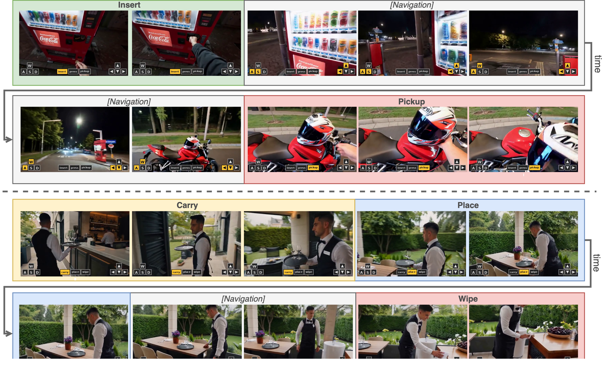

<h1 align="center">ActWorld: From Explorable to Interactive World Model via Action-Aware Memory</h1>

<h4 align="center">NeurIPS 2026</h4>

<p align="center">
<a href="https://arxiv.org/abs/2606.17730"></a>
<a href="https://interactwm.github.io/ActWorld"></a>
<a href="https://neurips.cc/"></a>
<a href="https://huggingface.co/xzhexiao/ActWorld"></a>
</p>

<p align="center">
<a href="https://steven-xiong.github.io/">Zhexiao Xiong</a><sup>1,2,*</sup>, <a href="https://song630.github.io/yizhisong.github.io">Yizhi Song</a><sup>2</sup>, <a href="https://scholar.google.com/citations?user=VeTCSyEAAAAJ&hl=en">Hao Kang</a><sup>2</sup>, <a href="https://scholar.google.com/citations?user=0TIYjPAAAAAJ&hl=en">Qing Yan</a><sup>2</sup>, <a href="https://liming-jiang.com/">Liming Jiang</a><sup>2</sup>, <a href="https://scholar.google.com/citations?user=cm297XMAAAAJ&hl=en">Jenson Yang</a><sup>2</sup>, <a href="https://scholar.google.com/citations?user=6bdPeKcAAAAJ&hl=en">Zhoujie Fu</a><sup>2</sup>, <a href="https://scholar.google.com/citations?user=ZHZczW8AAAAJ&hl=en">Stathi Fotiadis</a><sup>2</sup>, <a href="https://angtianwang.github.io/">Angtian Wang</a><sup>2</sup>, <a href="https://openreview.net/profile?id=~Zichuan_Liu4">Zichuan Liu</a><sup>2</sup>, <a href="https://scholar.google.com/citations?user=NOgz-HsAAAAJ&hl=en">Bo Liu</a><sup>2</sup>, <a href="https://ihollywhy.github.io/">Yiding Yang</a><sup>2</sup>, <a href="https://scholar.google.com/citations?hl=en&user=mFC0wp8AAAAJ">Xin Lu</a><sup>2</sup>, <a href="https://jacobsn.github.io/">Nathan Jacobs</a><sup>1</sup>
<br>
<sup>1</sup>Washington University in St. Louis &nbsp;&nbsp; <sup>2</sup>Intelligent Creation, ByteDance
<br>
<sup>*</sup>Work done during internship at ByteDance
</p>

---

ActWorld is an interactive world model that extends navigation-centric video generators to support **mid-rollout object interaction** (e.g., pick up, open, pour, place) together with **keyboard/mouse viewpoint control**, within a single chunk-autoregressive model built on [Helios](https://github.com/PKU-YuanGroup/Helios) (Wan2.1-14B).

## 📰 News

- **2026.10.26** Inference code and the base checkpoint are released.
- **2026.09.24** ActWorld is accepted to **NeurIPS 2026**.
- **2026.06.16** Paper released on [arXiv](https://arxiv.org/abs/2606.17730).

## 💡 Overview

<p align="center">

</p>

## 🗂️ Release Status

- [x] Inference code
- [x] Stage-1 base checkpoint (50-step sampling)
- [ ] Training code

## 🛠️ Installation

```bash
git clone https://github.com/Steven-Xiong/ActWorld.git
cd ActWorld

conda create -n actworld python=3.11
conda activate actworld

# Install PyTorch for your CUDA version, e.g. CUDA 12.8:
pip install torch==2.10.0 torchvision==0.25.0 torchaudio==2.10.0 --index-url https://download.pytorch.org/whl/cu128

bash install.sh
```
<!-- TODO: install.sh currently reinstalls wandb; drop it for the inference-only release. -->

## 📦 Model Download

ActWorld is trained on top of Helios-Base. Helios-Base provides the VAE, the UMT5 text encoder and the scheduler; ActWorld provides the transformer.

| Model | Download | Contents |
|---|---|---|
| Helios-Base | 🤗 [BestWishYsh/Helios-Base](https://huggingface.co/BestWishYsh/Helios-Base) | Backbone (DiT, VAE, UMT5 text encoder) |
| ActWorld (Stage-1 base, full model) | 🤗 [xzhexiao/ActWorld](https://huggingface.co/xzhexiao/ActWorld) | `merged/` (58.5 GB): full transformer with LoRA and all new modules merged in. `lora/` (3.8 GB): the same weights as LoRA + extras on top of Helios-Base. `action_embeds_cache.pt`: text-camera embeddings |

```bash
pip install -U "huggingface_hub[cli]"
hf download BestWishYsh/Helios-Base --local-dir checkpoints/Helios-Base
hf download xzhexiao/ActWorld --include "merged/*" "action_embeds_cache.pt" --local-dir checkpoints/ActWorld
```

## 🚀 Inference

ActWorld generates video in chunks of **33 frames** at 384×640, starting from a first frame. Each chunk can be steered by:

- a keyboard command (`W`, `A`, `S`, `D` and combinations, or `None`) and a mouse command (`↑ ↓ ← →` and combinations, or `·` for idle);
- a short caption describing what happens in that chunk (e.g. "the person places the plate on the table").

Run the 8 I-Bench samples in [`example/`](example):

```bash
bash infer.sh                              # writes outputs/actworld/<id>.mp4
NUM_GPUS=8 bash infer.sh                   # one sample per GPU
```

`infer.sh` loads `checkpoints/ActWorld/merged` together with `checkpoints/Helios-Base`. If `merged/` is missing, it falls back to `checkpoints/ActWorld/lora` (see below).

### Input format

To run your own inputs, arrange them like `example/` and run `INPUT_DIR=my_inputs bash infer.sh`:

```
my_inputs/
├── prompts.csv              # one row per video
├── first_frames/<id>.jpg
├── annotations/<id>.json    # optional: per-chunk captions and interaction labels
└── cameras/<id>/            # optional: camera trajectory
    ├── poses.npy
    └── intrinsics.npy
```

**`prompts.csv`** has the columns `id, prompt, image_name, chunk_actions_json`:

| Column | Meaning |
|---|---|
| `id` | Sample name; also the output file name and the name of its annotation / camera entries |
| `prompt` | Global caption of the whole video |
| `image_name` | First-frame file inside `first_frames/` |
| `chunk_actions_json` | One `[keyboard, mouse]` pair per chunk, e.g. `[["W", "·"], ["W+A", "←"], ["None", "↑"]]` |

**`annotations/<id>.json`** gives each chunk its own caption, which is how interaction commands reach the model, plus the interaction labels that EAFR uses to rank history frames (as in training):

```json
{
  "action_class": "fp_real_carry_place_pickup",
  "chunks": [
    {"description": "The subject lifts the plate of food off the counter.", "phase": "lifting", "has_interaction": true},
    {"description": "The subject carries the plate toward the dining table.", "phase": "manipulating", "has_interaction": true}
  ]
}
```

The captions are encoded with the same UMT5 encoder used to build the training data. `approaching`, `reaching`, `contact`, `manipulating`, `completing` and `post_action` have dedicated EAFR priors; any other phase name (e.g. `lifting`, `releasing`) is treated as a generic phase, as in training. Without an annotation file, every chunk uses the global `prompt`, and EAFR ranks history by recency and by an interaction flag derived from the keyboard command.

**`cameras/<id>/`** holds the camera trajectory for the Plücker branch: `poses.npy` is `(N, 4, 4)` camera-to-world matrices and `intrinsics.npy` is `(N, 4)` `fx, fy, cx, cy` on the 384×640 grid, with 33 frames per chunk. The examples ship the trajectories recovered by ViPE from the reference videos. Without a camera folder, the trajectory is derived from the keyboard/mouse commands.

### Options

| Variable | Default | Meaning |
|---|---|---|
| `INPUT_DIR` | `example` | Input folder (layout above) |
| `OUTPUT_DIR` | `outputs/actworld` | Where videos are written |
| `NUM_GPUS` | `1` | Data-parallel inference: each GPU generates different samples |
| `NUM_FRAMES` | `330` | Video length (10 chunks) |
| `BASE_MODEL`, `ACTWORLD` | `checkpoints/...` | Checkpoint locations |

> **Note.** The persistent memory bank stays **disabled** for the released checkpoint: `infer.sh` does not pass `--event_memory_enabled` or `--object_memory_enabled`. The bank modules stay in the code to document the full architecture.

<details>
<summary>Using the <code>lora/</code> format instead</summary>

`lora/` (3.8 GB) holds the same weights as LoRA + extras on top of Helios-Base, a much smaller download than `merged/`. Download it instead of `merged/` and run `infer.sh` as above; it detects that `merged/` is absent and applies the LoRA to Helios-Base:

```bash
hf download xzhexiao/ActWorld --include "lora/*" "action_embeds_cache.pt" --local-dir checkpoints/ActWorld
bash infer.sh
```

The LoRA is applied at runtime, so outputs match `merged/` up to bf16 rounding.
</details>

## 🙏 Acknowledgements

This project builds on [Helios](https://github.com/PKU-YuanGroup/Helios) and [Wan2.1](https://github.com/Wan-Video/Wan2.1). We also use [DINOv3](https://github.com/facebookresearch/dinov3) and [ViPE](https://github.com/nv-tlabs/vipe). We thank the authors for releasing their code and models.

## 📜 License

This repository is released under the [MIT License](LICENSE). Code derived from Helios keeps its original [Apache-2.0 License](LICENSE.txt).

## ✏️ Citation

If you find ActWorld useful, please cite:

```bibtex
@inproceedings{xiong2026actworld,
  title     = {ActWorld: From Explorable to Interactive World Model via Action-Aware Memory},
  author    = {Xiong, Zhexiao and Song, Yizhi and Kang, Hao and Yan, Qing and Jiang, Liming and Yang, Jenson and Fu, Zhoujie and Fotiadis, Stathi and Wang, Angtian and Liu, Zichuan and Liu, Bo and Yang, Yiding and Lu, Xin and Jacobs, Nathan},
  booktitle = {Advances in Neural Information Processing Systems (NeurIPS)},
  year      = {2026},
  eprint    = {2606.17730},
  archivePrefix = {arXiv}
}
```
